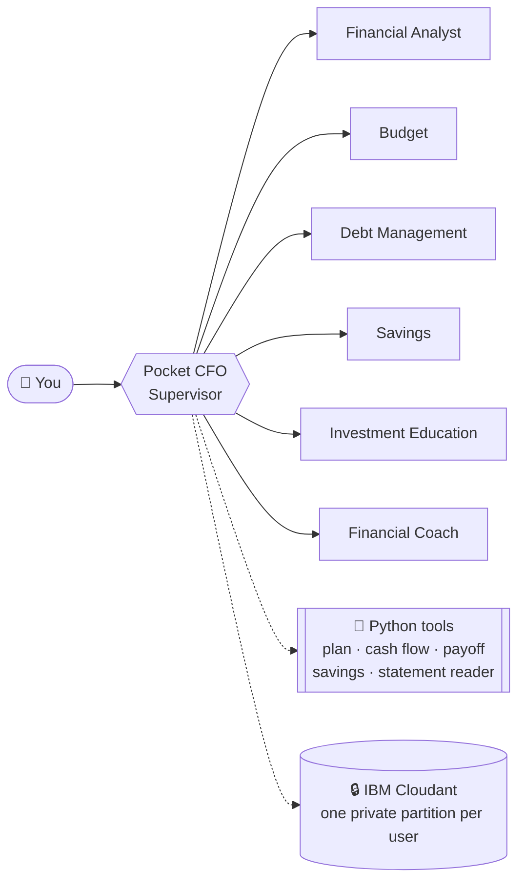

<div align="center">

# 💼 Pocket CFO

**Your personal finance coach**

Built on **IBM watsonx Orchestrate**. Python does every calculation, so the agents explain
your numbers instead of guessing them.


[What it does](#-what-it-does) · [How it works](#-how-it-works) · [Example](#-example) · [Quick start](#-quick-start) · [Privacy](#-privacy--security) · [Technical docs](watsonx/README.md)

</div>

---

## ✨ What it does

| | |
|---|---|
| 📊 **Understands your money** | Income, spending by category, fixed vs. flexible costs, and what's above typical ranges |
| 📄 **Reads your statements** | Upload a bank or credit-card statement (**CSV or PDF**) and get monthly totals in seconds |
| 🧾 **Builds a budget** | Realistic category limits, with the savings calculated rather than estimated |
| 💳 **Plans debt payoff** | Month-by-month avalanche plan: debt-free date, interest paid, interest saved |
| 🏦 **Grows your safety net** | Emergency-fund goal, timeline, and progress since last time |
| 📈 **Teaches investing** | Plain-language education with hypothetical growth examples, never stock picks |
| 📅 **Monthly check-ins** | Compares where you are with where the plan said you'd be: on track, ahead or behind |
| 🔒 **Remembers, only if you ask** | Saved per user in IBM Cloudant; export or delete everything at any time |

---

## 🧠 How it works



- The **Supervisor** routes each question to the right specialist and keeps the conversation on track.
- **Specialists** explain, and **Python tools** calculate. One tool (`build_financial_plan`) produces
  every number in a full plan, so agents never contradict each other.
- **Guidelines** handle the sensitive cases: no stock picks, no money movement, never another
  person's data, and a confirmation code before anything is deleted.

---

## 💬 Example

> **You:** I take home $3,500 a month. Rent $1,200, groceries $400, utilities $150, transport $200,
> eating out $250, shopping $200, fun $100, other $200. I owe $8,000 on a card at 22% (minimum $240)
> and have $1,000 saved toward a $5,000 emergency fund.

> **Pocket CFO:**
> 🩺 You have an **$800** monthly surplus.
> 📅 Pay **$632/month** to the card and save **$168/month**.
> 🏁 **Month 15:** debt-free (estimate), with **$1,187.26** interest paid, **$3,289.62** less than paying only the minimum.
> 🏁 **Month 17:** emergency fund reached (estimate).

Every number above comes from the tools, and the test suite checks these exact values.

---

## 🚀 Quick start

**You need:** Python 3.11+, git, and (for deployment) an IBM Cloud account with
watsonx Orchestrate and Cloudant. Windows users: PowerShell 7 (`pwsh`).

```bash
git clone https://github.com/Kay116/Pocket_CFO_ai_agent.git
cd Pocket_CFO_ai_agent
python -m venv .venv
# Windows: .venv\Scripts\Activate.ps1   ·   macOS/Linux: source .venv/bin/activate
pip install --upgrade ibm-watsonx-orchestrate ibmcloudant pypdf==5.1.0 pytest
pytest watsonx/tests -q          # runs offline, no IBM account needed
```

To run it in watsonx Orchestrate, follow the three steps below.

<details>
<summary><b>① Set up Cloudant (once)</b></summary>

1. Cloudant instance → **Manage → Authentication method** → **IAM only**.
2. Copy the URL from **Manage → Overview → External endpoint** (starts with `https://`; not the private one).
3. Create the databases with a key that has the **Manager** role (your own IBM Cloud API key works):
   ```bash
   export CLOUDANT_URL="https://<your-account>.cloudantnosqldb.appdomain.cloud"
   export CLOUDANT_APIKEY="<setup key>"
   python watsonx/db/setup_cloudant.py
   ```
   *(Windows: `$env:CLOUDANT_URL = "..."` instead of `export`.)*
4. Create the **runtime** key: IBM Cloud → **Manage → Access (IAM) → Service IDs** → create one →
   access **Cloudant → this instance → Writer** → **API keys → Create**.
   Optional check: `python watsonx/db/check_cloudant.py`.
5. Generate a **pepper** once and store it in a password manager. If it changes, saved users lose access to their data.
   ```bash
   python -c "import secrets; print(secrets.token_hex(32))"
   ```
</details>

<details>
<summary><b>② Connect to watsonx Orchestrate (once)</b></summary>

1. Instance URL: watsonx Orchestrate → profile icon → **Settings → API details**.
2. API key: IBM Cloud → **Manage → Access (IAM) → API keys → Create**, then click **Copy** in the pop-up.
   The key is shown only once; the `ApiKey-…` value in the list is its *ID*, not the key.
3. Register the environment:
   ```bash
   orchestrate env add -n pocket-cfo -u <instance-url> --type ibm_iam
   ```
</details>

<details open>
<summary><b>③ Upload the agents and tools</b></summary>

**Windows (guided).** The script asks you to copy each secret and press Enter, checks the key with
IBM, backs up existing agents, then imports everything. Secrets are never printed:
```powershell
pwsh -NoProfile -ExecutionPolicy Bypass -File .\watsonx\deploy_pocket_cfo.ps1 -EnvName pocket-cfo
```

**macOS / Linux:**
```bash
orchestrate env activate pocket-cfo
export CLOUDANT_URL="https://<your-account>.cloudantnosqldb.appdomain.cloud"
export CLOUDANT_RUNTIME_APIKEY="<runtime key>"
export USER_KEY_PEPPER="<pepper>"
bash watsonx/import_all.sh
```

Then open **Pocket CFO Supervisor**, start a **new** chat in Draft Preview, run the
[test script](watsonx/README.md#-test-script-draft-preview), and click **Deploy**.
</details>

> 💡 After changing anything in `agents/` or `tools/`, run step ③ again and test in a **new** chat.
> An old chat can keep the previous behaviour.

---

## 🔒 Privacy & security

- **Only your own data.** Identity comes from the platform, never from the chat, so nobody can ask for someone else's data.
- **Anonymous storage.** Emails are never stored; each user is an HMAC-hashed ID in their own Cloudant partition.
- **Saved only with consent.** Delete needs a one-time code the user types back.
- **Statements stay private.** Uploaded files are summarised in memory and discarded; account numbers are masked.
- **No secrets in git.** Keys live in environment variables and the watsonx connection. `.gitignore`
  also blocks `.env`, backups, statement files and editor/assistant folders.

If a key ever appears in a terminal, chat or screenshot, **delete it in IBM Cloud and create a new one.**
Full details: [security design](watsonx/README.md#-security-design).

---

## 🛠 Troubleshooting

<details>
<summary>Show common errors and fixes</summary>

| Message | Fix |
|---|---|
| `BXNIM0415E Provided API key could not be found` | You copied the key's ID, or a deleted key. Create a new key and click **Copy** in the pop-up. |
| `Error getting IBM_IAM Token` | Same as above, or the key belongs to a different IBM Cloud account than the Orchestrate instance. |
| `token ... is missing or expired` | Run `orchestrate env activate <name>` again, or the deploy script. |
| `connection ... 'pocket_cfo_cloudant' already exists` | Normal on a re-import; the script updates its credentials and continues. |
| `.\watsonx\...ps1 is not recognized` | You're already inside `watsonx`; run `.\import_all.ps1`. |
| The agent behaves the old way | Re-run step ③ and open a **new** chat. |
| "Unable to read any transactions" | Scanned (image) PDFs can't be read; download a CSV or a text PDF from online banking. |
</details>

---

## 📁 Project structure

```
watsonx/
├── agents/                  7 agent definitions (YAML)
├── tools/                   Python tools: plan, cash flow, payoff, savings, statements, Cloudant data
├── tests/                   pytest suite (offline: fake Cloudant + sample statements)
├── db/                      Cloudant setup and connection check
├── deploy_pocket_cfo.ps1    guided Windows deploy
├── import_all.ps1 / .sh     upload tools and agents
└── backup_agents.ps1        download current agents before overwriting
```

---

<sub>⚠️ Pocket CFO provides general education and estimates, not personalized financial or investment advice.</sub>
